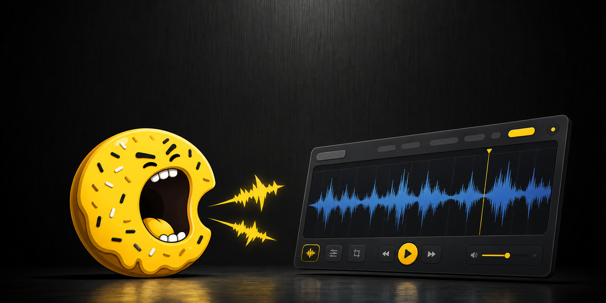

<div align="center">



# Slaive

**Voice input that lands where you are working — and never leaves your machine.**

macOS menu-bar app · Tauri 2 · Rust · whisper.cpp

</div>

---

## The problem

Dictation on a Mac is either accurate or private, rarely both.

The built-in dictation sends audio to Apple. Third-party tools send it somewhere
else. Anything genuinely local is usually a command-line toy you have to babysit:
record a file, run a binary, copy the output, paste it yourself.

And when it does work, the text arrives in the wrong place. You dictate into a
window, then move it by hand into the editor, terminal or chat you actually meant.

Slaive fixes both halves. Speech is transcribed by whisper.cpp **on your machine**,
and the result is pasted straight back into the application you were in when you
pressed the hotkey.

## What it does

| | |
|---|---|
| **Speaks nowhere** | whisper.cpp runs locally, accelerated by Metal. The only network traffic is downloading a model from Hugging Face — and AI actions, if you turn them on. |
| **Lands in the right app** | The panel never steals focus while you speak, so the app underneath stays frontmost. Paste restores focus to it and sends ⌘V. |
| **Shows you the signal** | A live level track draws the raw microphone input. macOS answers a denied permission with a stream of zeros rather than an error — this is how you tell a dead microphone from a quiet room. |
| **Trims the silence** | Silero VAD cuts pauses before transcription, so the model stops inventing words where nobody spoke. |
| **Edits like Vim** | The transcript sits in a real editor with Vim bindings — navigate, fix and send without reaching for the mouse. |
| **Keeps dictating** | Hold the hotkey again with the panel open and the new speech is appended to what is already there, including your hand edits. |
| **Understands your jargon** | A dictionary of terms is passed to whisper as a prompt, so `Kubernetes` stops coming back as `Кубернетес`. Seeded with backend, frontend and cloud vocabulary. |
| **Rewrites on request** | Optional AI actions — translate, ask, fix, shorten, summarize — applied in a separate window, with accept or cancel before anything replaces your text. |

## How it feels

```
hold hotkey  →  speak  →  release
                            ↓
                  ┌──────────────────────┐
                  │ 🤖  Cursor           │   the app you came from
                  │ ▁▃▇█▆▃▁▂▅█▇▄▂        │   raw level, playable
                  │ ┌──────────────────┐ │
                  │ │ what you said    │ │   editable, Vim
                  │ └──────────────────┘ │
                  │ [Paste ⏎] [Copy] [→] │
                  └──────────────────────┘
                            ↓
              text appears where you were typing
```

## Requirements

- macOS 12 or later, Apple silicon
- Rust, `cmake` (`brew install cmake`), Node.js 20+

## Running

```bash
npm install
npm run tauri dev
```

Settings open on first launch. Pick a whisper model and download it; `small` is a
good default, `large-v3-turbo` is noticeably better on mixed-language speech and
in noisy rooms.

## Permissions

macOS asks for two, and they are asked by different parts of the system:

- **Microphone** — to record at all.
- **Accessibility** — to send ⌘V into another application. Slaive checks this
  before trying, and offers a route to the right settings pane if it is missing.

Copy works without either of them beyond the microphone, so a refused
accessibility prompt costs you the automatic paste, not the app.

## Building

```bash
npm run tauri build
```

Produces `Slaive.app` and a `.dmg` under `src-tauri/target/release/bundle/`. The
build is **unsigned**: the first launch needs right-click → Open, and the image
should not be handed to anyone else as-is.

## Architecture

```
src-tauri/src/
  commands.rs   the only #[tauri::command] layer — orchestration, no logic
  audio.rs      microphone capture; knows nothing about whisper
  whisper.rs    transcription; knows nothing about Tauri
  ai.rs         AI provider access; knows nothing about Tauri
  macos.rs      the only place with platform calls
src/
  Overlay.tsx       the recording panel
  MainWindow.tsx    text plus the action menu
  Settings.tsx      five sections
  transcript-editor.ts  the shared CodeMirror + Vim editor
```

Audio reaching whisper is always f32, 16 kHz, mono. Transcript text is never
logged — it is the user's own speech.

## Tests

```bash
cd src-tauri && cargo test    # Rust
npm test                      # pure TypeScript logic
```

## Licence

Private project. No licence granted.
